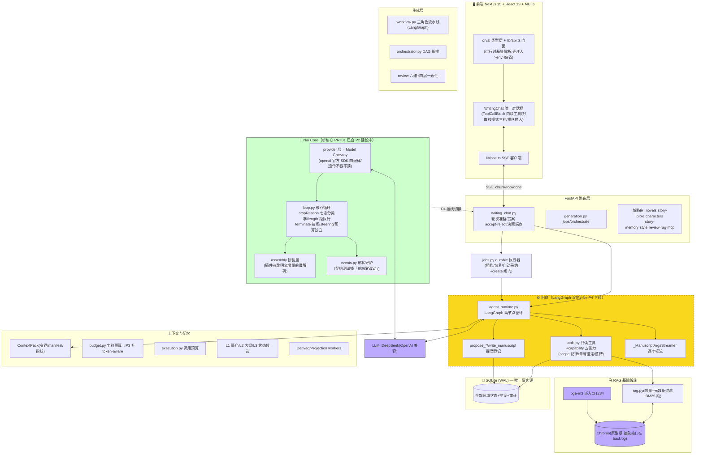

# 墨枢系统架构图

> 2026-10-03 v2 维护版，对应 main@PR#31 后的双轨实态。
> 本文档由 team-lead 维护，含：实态架构图 / 双轨现状 / 架构评审记录（两轮）/ 已知差距与 backlog / 目标边界。

## 一、实态架构图（双轨期）

**绿框 = Nai Core 新核心（参考 pi Core 架构自研，旧链零改动并行）**；黄虚线框 = 旧 LangGraph 链（双轨运行至 P4 下线）；蓝框 = 三方。

## 二、双轨现状

| 轨 | 状态 | 下线点 |
|---|---|---|
| 旧链（LangGraph 循环） | 生产运行中 | P4：writing_chat 接线切换到 Core 后退役 |
| Nai Core | P1 已合（provider 四纪律/循环/分类学/事件守护，+38 测试）；P2 建设中（幂等节点+契约类型层+可观测五元组+预算三口径） | — |

**切换验收线**：前端事件序零改动（events.py 契约测试锁定）。

## 三、架构评审记录（2026-10-03，两轮）

| 轮次 | 评分 | 性质 |
|---|---|---|
| 第一轮 | 8/10（战略 9/工程 7） | 七点警戒+五层目标边界 |
| 第二轮（对照 2025-26 生产实践） | 6.5/10（战略 9/工程 5） | 四维差距：状态管理/持久化/上下文预算/可观测 |

### 已采纳（折入设计稿与 backlog）

1. **采纳 outbox 一致性**（高优 backlog#1，排期=Core P4 后同窗）：采纳事务内写正式内容+墓碑+outbox 事件；投影 worker 幂等消费；检索侧 deleted_at/version 过滤兜底；嵌入模型版本记录。
2. **可观测层**（高优 backlog#2）：LLM 调用五元组（model/prompt hash/context pack id/token/成本/延迟）、检索命中与分数、提案采纳率/回滚率/作者修改距离、恢复成功率。
3. **预算降级分级**（高优 backlog#3）：预算尽→减检索→减工具→请作者。
4. **Token-aware 预算重设计**（P3 升格）：三层上下文模型（Persistent 5-15%/Session 20-40%/Ephemeral 余量）+ output reserve 20-30%（窗口内预留）。
5. **Durable execution 对表**：步骤级重试/幂等键体系（N3 uuid5 亮点泛化）/断连从最后成功步恢复/失败态可查询——作 Core+jobs 的验收标准。
6. **Message/ToolSpec 自有契约类型层**（P2）；VectorStore 抽象+BM25/RRF 混合检索（中优 backlog）。

### 已评估·不采纳（防复审翻案）

| 建议 | 不采纳理由 |
|---|---|
| LangGraph checkpointer + PostgresSaver 做 HITL | ① 时态错位：Core 已替换循环（pi 路线：轻量会话持久化+领域状态自恢复）；② Postgres 违背桌面壳/本地优先形态决策；③ checkpointer 状态库+Nai DB=双事实源，违反评审自身第 3 条。HITL 健壮性由 durable-execution 清单验收 Core+jobs 达成。 |

### 评审事实纠偏

- 「可观测完全缺失」→ 系统层 tracing 确缺（采纳）；但用量行/执行记录/提案审计链/auto: 前缀在（表述过重）。
- 「LangGraph 用得浅是最大风险」→ 评审基于旧照；Core P1 已落地替换路径，风险敞口正在收敛。

## 四、目标边界（评审五层 × 本系统映射）

| 评审层 | 本系统对应 | 状态 |
|---|---|---|
| Nai Core（领域状态机/提案/裁决/章号/墓碑/scope/预算/ContextPack） | 域服务+提案流 | ✅ 存量资产 |
| Model Gateway（适配/调用/流式/重试/限流/成本统计） | Core provider 层 | ✅ P1 已建（四纪律） |
| Orchestrator（图执行器/状态外置） | 旧 LangGraph→Core loop | 🔄 双轨中 |
| Retrieval（可换向量库/outbox 投影） | rag.py+Chroma | ⚠️ backlog（抽象+BM25） |
| Jobs（幂等键/租约/心跳/死信/重放） | jobs.py | ⚠️ 对表清单验收中 |

## 五、维护纪律

- 本图随架构级 PR 同步更新（team-lead 职责）；
- 评审/决策记录只增不删，翻案须新证据；
- backlog 明细见 `.Codex/backlog.md`（七条），设计稿见 `.Codex/core-agent-design.md`（含 §八评审对照表）。
